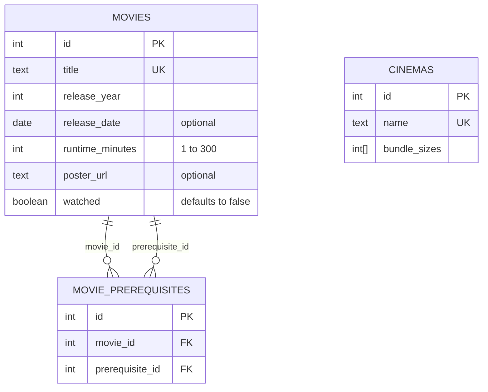

# Doomsday Ready

Doomsday Ready is a React and FastAPI app for planning a movie rewatch and finding the fewest cinema ticket bundles that seat a group exactly. Docker Compose runs PostgreSQL locally. The hosted backend uses Neon.

## Algorithms

### Feature 1 — Rewatch order

Movies and their prerequisites form a directed graph. Each movie points to the movies that must be watched before it. Depth-first search (DFS) follows those links from the target and uses a set of finished movies so that a shared prerequisite appears only once.

A topological sort builds the watch order in rounds. Each round contains the movies whose prerequisites were all completed in earlier rounds. Movies within a round are sorted by release date from earliest to latest, with release year as a fallback when the full date is unavailable.

The app rejects self-links. DFS detects cycles by tracking the movies on its current path. When validating a proposed link, it also checks whether the proposed prerequisite already leads back to the movie being edited. Either kind of cycle returns `409 CIRCULAR_DEPENDENCY`.

The rewatch algorithm is in [`BE/movie_graph.py`](BE/movie_graph.py).

### Feature 2 — Exact cinema booking

The booking algorithm solves a minimum coin change problem with dynamic programming. Bundle sizes are the coin values, and the group size is the target. Starting at zero seats, the algorithm works up to the target. For each seat total, it tries every bundle size that fits, looks up the minimum count for the remaining seats, and adds one for the bundle it just tried. It keeps the lowest count among the choices that fill the remainder exactly. If the target is unreachable, the quote reports that booking is impossible.

For each reachable total, the algorithm also records the bundle size that gave the lowest count. It starts at the group size, subtracts each recorded bundle, and counts how many of each size to buy.

The booking algorithm is in [`BE/booking.py`](BE/booking.py).

## Run with Docker Compose

With Docker Compose 2.24 or later, run from the repository root:

```sh
docker compose up --build
```

Open [the app](http://localhost:5173) or [Swagger UI](http://localhost:5173/docs). Compose starts the frontend, FastAPI, and PostgreSQL. The database starts with the tables in [`BE/schema.sql`](BE/schema.sql) and saves data in a Docker volume across restarts. The local app works without a `.env` file.

The TMDB read token is hardcoded in FastAPI solely so assessment reviewers can run search and autofill locally without creating a TMDB account or configuring a token. For hosted deployments, set `TMDB_READ_TOKEN` in the backend environment to override the bundled token. See [`BE/.env.example`](BE/.env.example). Manual movie entry is available if TMDB is unavailable.

### Hosted backend

Set `DATABASE_URL` to your Neon connection string in the hosting provider’s backend environment. For a fresh Neon database, apply [`BE/schema.sql`](BE/schema.sql) once before starting the app. If you run Compose with Neon, set `DATABASE_URL` in your shell or a root `.env` file to override the local connection.

## Data model



Each prerequisite link means `movie_id` needs `prerequisite_id` first. Cinemas are independent of the movie library. A booking quote is calculated from a cinema’s bundle sizes and isn’t stored.

## API Reference

All endpoints below use the `/api` prefix. Replace `:id` with the saved movie or cinema ID.

| Method | Path | Purpose |
| --- | --- | --- |
| `POST` | `/api/movies` | Create a movie. |
| `GET` | `/api/movies` | List saved movies. |
| `PATCH` | `/api/movies/:id` | Update a movie, including its watched status and prerequisites. |
| `GET` | `/api/movies/:id/rewatch-order` | Get the rewatch order and progress for a target movie (Feature 1). |
| `POST` | `/api/cinemas` | Create a cinema and save its bundle sizes. |
| `GET` | `/api/cinemas` | List saved cinemas. |
| `GET` | `/api/cinemas/:id/booking?groupSize=6` | Get an exact booking quote for the group (Feature 2). |

## Submission

Submit the Git repository link through the Google Form that delivered the challenge.

## Credits

This product uses the TMDB API but is not endorsed or certified by TMDB. [TMDB attribution requirements](https://developer.themoviedb.org/docs/faq#what-are-the-attribution-requirements)

AI assistance helped refine the frontend and prepare the documentation.
