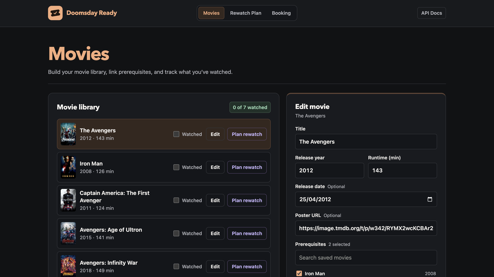
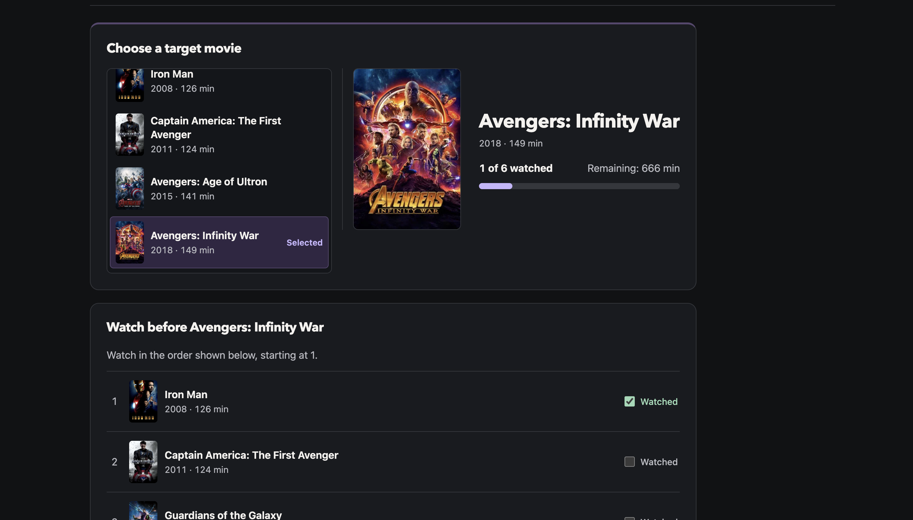
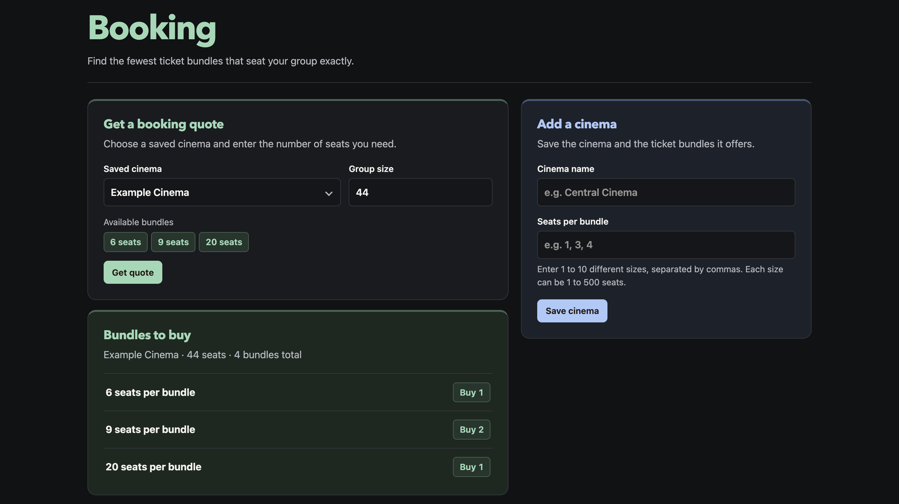
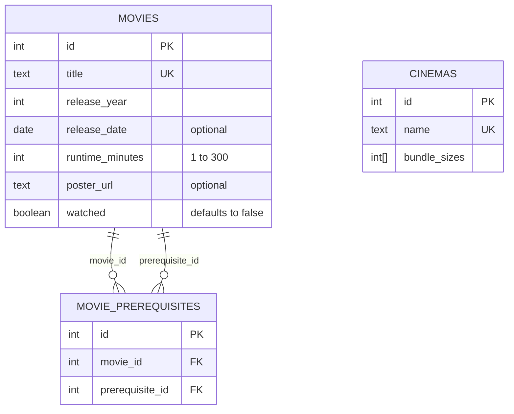

# Doomsday Ready

Doomsday Ready is a React and FastAPI app for planning a movie rewatch and finding the fewest cinema ticket bundles that seat a group exactly.

- **Live site** · [Doomsday Ready on Vercel](https://blinto-assesment-murex.vercel.app/)
- **Hosted API** · [FastAPI on Render](https://blinto-assesment.onrender.com/) · [Swagger UI](https://blinto-assesment.onrender.com/docs)

## Algorithms

### Feature 1 — Rewatch order

Movies and their prerequisites form a directed graph. Each movie points to the movies that must be watched before it. Depth-first search (DFS) follows those links from the target and uses a set of finished movies so that a shared prerequisite appears only once.

A topological sort builds the watch order in rounds. Each round contains the movies whose prerequisites were all completed in earlier rounds. Movies within a round are sorted by release date from earliest to latest, with release year as a fallback when the full date is unavailable.

The app rejects self-links. DFS detects cycles by tracking the movies on its current path. When validating a proposed link, it also checks whether the proposed prerequisite already leads back to the movie being edited. Either kind of cycle returns `409 CIRCULAR_DEPENDENCY`.

The rewatch algorithm is in [`BE/movie_graph.py`](BE/movie_graph.py).

**Simplified algorithm**

```text
Run DFS from the target to collect its prerequisites.
    If a movie is already on the current path, report a cycle.
    If it is already finished, skip it.
    Otherwise, visit its prerequisites before marking it finished.

Exclude the target from the result.
While prerequisites remain:
    Gather every movie whose prerequisites were finished in earlier rounds.
    Sort that round by release date or year.
    Append the entire round to the watch order.
```





### Feature 2 — Exact cinema booking

The booking algorithm solves a minimum coin change problem with dynamic programming. Bundle sizes are the coin values, and the group size is the target. Starting at zero seats, the algorithm works up to the target. For each seat total, it tries every bundle size that fits, looks up the minimum count for the remaining seats, and adds one for the bundle it just tried. It keeps the lowest count among the choices that fill the remainder exactly. If the target is unreachable, the quote reports that booking is impossible.

For each reachable total, the algorithm also records the bundle size that gave the lowest count. It starts at the group size, subtracts each recorded bundle, and counts how many of each size to buy.

The booking algorithm is in [`BE/booking.py`](BE/booking.py).

**Simplified algorithm**

```text
Set best[0] to 0 bundles and mark every other seat total unreachable.
For each seat total from 1 to the group size:
    For each bundle size that fits:
        If the remaining seats are reachable, try 1 + best[remaining seats].
        If this improves best[seat total], save the count and bundle size.

If the group size is unreachable, return "Not possible".
Otherwise, work backward from the group size using the saved bundle sizes.
Count how many bundles of each size to buy.
```



## Run with Docker Compose

On the `main` branch, run this from the repository root with Docker Compose v2:

```sh
docker compose up --build
```

Open [the app](http://localhost:5173) or [Swagger UI](http://localhost:5173/docs). Compose starts React, FastAPI, and PostgreSQL. FastAPI connects to the PostgreSQL container over Docker’s internal network. On the first run, PostgreSQL creates its tables from [`BE/schema.sql`](BE/schema.sql). No `.env` file or database account is needed.

Run `docker compose down` to stop the app. Movies and cinemas are kept in the Docker volume for the next run.

The TMDB read token is bundled solely so assessment reviewers can try search and autofill locally. To override it in Compose, set `TMDB_READ_TOKEN` in a `.env` file at the repository root. Manual movie entry is available if TMDB is unavailable.

The live links above use the separate `hosted` branch.

## Data model



Each prerequisite link means `movie_id` needs `prerequisite_id` first. Cinemas are independent of the movie library. A booking quote is calculated from a cinema’s bundle sizes and isn’t stored.

## API Reference

All endpoints below use the `/api` prefix. Replace `:id` with the saved movie or cinema ID. Use the ID returned by TMDB search for `:tmdb_id`.

| Method | Path | Purpose |
| --- | --- | --- |
| `POST` | `/api/movies` | Create a movie. |
| `GET` | `/api/movies` | List saved movies. |
| `PATCH` | `/api/movies/:id` | Update a movie, including its watched status and prerequisites. |
| `GET` | `/api/movies/:id/rewatch-order` | Get the rewatch order and progress for a target movie (Feature 1). |
| `POST` | `/api/movies/validate-prerequisites` | Check proposed prerequisite links without saving them. |
| `POST` | `/api/cinemas` | Create a cinema and save its bundle sizes. |
| `GET` | `/api/cinemas` | List saved cinemas. |
| `GET` | `/api/cinemas/:id/booking?groupSize=6` | Get an exact booking quote for the group (Feature 2). |
| `GET` | `/api/movie-lookup/search?q=Avengers` | Search TMDB for matching movie titles, posters, and IDs. |
| `GET` | `/api/movie-lookup/:tmdb_id/details` | Get a TMDB movie’s release date, year, and runtime for autofill when available. |

## Submission

Submit the Git repository link through the Google Form that delivered the challenge.

## Credits

This product uses the TMDB API but is not endorsed or certified by TMDB. [TMDB attribution requirements](https://developer.themoviedb.org/docs/faq#what-are-the-attribution-requirements)

AI assistance helped refine parts of the project, prepare the documentation and create the docker compose file.
